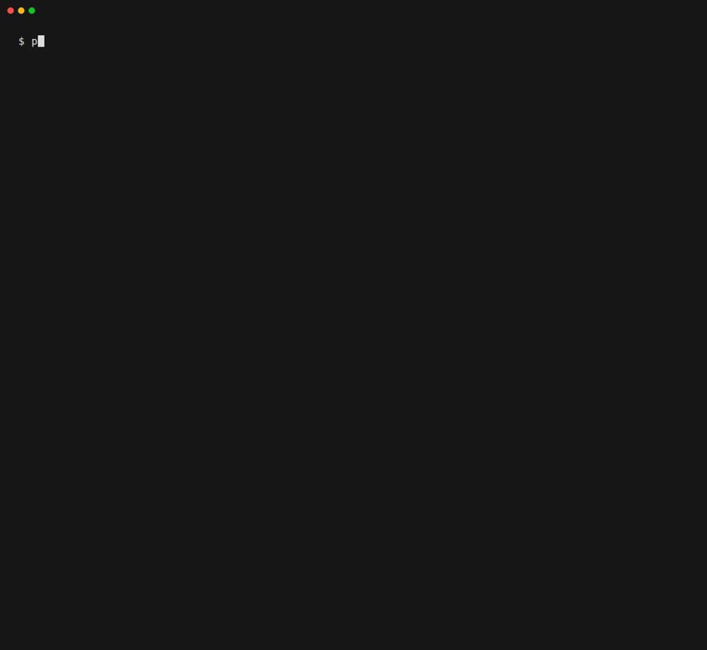

v0.1 covers non-interactive CLIs.

# Port Anything

> Rewrite it in Rust (or Go, TS, Swift…) and *show* nothing changed.

Port Anything records what a program actually does, generates thousands more test cases, runs the original and the port side by side, and reports a parity score with a minimal reproducer for every difference. It is packaged so a coding agent (Claude Code, Codex, Cursor, Gemini CLI) can drive the whole port.



One command, no configuration: `compare` infers the command-line spec from the reference, generates test cases, runs them in a sandbox against the reference and each candidate, and scores parity per feature. The demo runs in the Linux dev container and is recorded from [`docs/demo/compare.tape`](docs/demo/compare.tape) with `docs/demo/record.sh`.

**Scope of v0.1:** black-box programs you can run as a process with pipes (argv, stdin, environment, input files), compared on exit code, stdout, stderr and file changes. One reference, one or more candidates. Linux first; macOS works by copying all fixtures into the sandbox or in container mode. Everything runs with pipes, never a terminal, so a program that changes its output when it sees a terminal is tested in its non-terminal mode. Programs that need a terminal (TUIs, interactive prompts), network services and GUI apps are out of scope for now.

**Status:** early. Commands, file formats and exit codes may still change before v1.0.

## Quickstart

Needs Node 22.15+. Nothing to configure: `compare` reads the reference's `--help`, generates 500 cases from it, runs the reference twice more to spot nondeterministic output, then runs every candidate in a sandbox and prints a parity score per candidate.

**Linux** (Debian 12, with the `rust-coreutils` and `bubblewrap` packages: GNU `sort` against the [uutils](https://github.com/uutils/coreutils) multicall binary):

```sh
npx port-anything compare /usr/bin/sort 'coreutils sort'
```

**macOS** (BSD `sort` against GNU `sort` from Homebrew coreutils):

```sh
brew install coreutils
npx port-anything compare /usr/bin/sort gsort
```

On Debian 12, the first one prints something like this (trimmed):

```
read "sort --help": 31 flags, 2 positional forms
every side runs as `sort` (argv[0] pinned) · sandbox: bwrap, no network
generated 500 cases (budget 500)
reference re-run 2× per case: 498 stable, 2 stable after normalizers, 0 flaky-reference (left out)
normalizers (cases changed): sort-lines on stdout for opt.sort 8

coreutils sort: parity 60.6%  (mean of 18 features; 314/500 cases)

  feature                                    parity
  base                                       80.0% 16/20
  opt.debug                                  0.0% 0/20
  opt.field-separator (under-sampled)        50.0% 9/18
  opt.key                                    30.0% 6/20
  opt.numeric-sort (under-sampled)           53.3% 8/15
  opt.reverse                                70.0% 14/20
  …
under-sampled: fewer than 20 cases, left out of the parity
untested (no generated case): opt.batch-size, opt.check, opt.C, opt.files0-from
```

The first argument is the reference: what it does is correct by definition. Every other argument is a candidate, and with several of them you get a feature × candidate matrix:

```sh
npx port-anything compare /usr/bin/sort 'coreutils sort' 'busybox sort'
```

Name the binaries explicitly: on Ubuntu 25.10 and later, plain `sort` already *is* uutils. Both sides run under the reference's program name (`argv[0]` is pinned), so a multicall binary such as `'coreutils sort'` or `'busybox sort'` works as a candidate, and error messages that start with the program's name don't count as differences.

| Option | What it does |
|---|---|
| `--budget N` | Number of generated cases (default 500) |
| `--json` | Print the result as JSON instead of text, for scripts and agents |
| `--save` | Write `port-anything.yaml` and the inferred `port-anything/cli-spec.yaml`: a project where `port-anything run` runs the same cases (never overwrites) |
| `--i-know` | Allow a tool known to be destructive (`rm`, `dd`, `mkfs`…) |
| `--no-sandbox` | Run without a sandbox, for programs you trust |

- **Sandbox.** `compare` fuzzes a program it knows nothing about, so every case runs without network access, in a scratch directory with relative paths only: bubblewrap on Linux (`unshare` as a fallback), `sandbox-exec` on macOS. If no sandbox works, `compare` refuses to run and says how to fix it.
- **Output.** Nothing is written unless you pass `--save`. Clusters of divergences, reproducers and the HTML report come with a project (below).
- **Exit codes:** 0 = no divergences, 1 = divergences (in a project with `compare.min_parity` set, a full run's parity below it instead; and a significant fresh-holdout gap), 2 = integrity broken (`verify`, in a project), 3 = usage or config error.

The score is the **mean of per-feature parity** (a feature is a flag, subcommand or input form), so a rarely used flag counts as much as the common path. Features with too few cases are shown but left out of the headline, and `--help`, `--version` and similar output, which differ between implementations by design, are reported on their own. Parity is evidence from the cases that ran, never a proof of equivalence.

## A project, for a real port

`compare` is zero-config. A port you work on for weeks gets a project instead: `port-anything.yaml` (how to build and run each side, the normalizers, the strictness profile) and a `port-anything/` directory with the cases, all committed. `compare --save` starts one. The generated cases aren't committed: every checkout regenerates the same ones from the CLI spec and the generator seed in the config.

```sh
npx port-anything compare ./ref/tool ./port/tool --save   # writes port-anything.yaml and port-anything/cli-spec.yaml
npx port-anything run                      # the same generated cases, against the candidate in the config
npx port-anything generate --budget 5000   # a bigger corpus; the budget and seed go into port-anything.yaml
npx port-anything baseline                 # run the reference 3 times per case, propose normalizers, freeze .port-anything/MANIFEST.json
npx port-anything verify                   # check the cases and the reference's output against the manifest
npx port-anything init . --ci              # a GitHub Actions workflow that recomputes the score on every push (see Integrity)
npx port-anything mcp                      # MCP server over stdio for your agent: status, next (repro + diff), run (fixed/broke deltas), case, features, probe
npx port-anything setup                    # register that server and the skills (port-loop, port-plan, port-audit, port-report) with each agent installed: Claude Code, Codex, Cursor, Gemini CLI
```

The repo is also a Claude Code plugin marketplace (`/plugin marketplace add karolkulesza/port-anything`, then `/plugin install port-anything@port-anything`) and a Gemini CLI extension (`gemini extensions install https://github.com/karolkulesza/port-anything`), with plugin manifests for Codex and Cursor; each brings the same skills and MCP server.

To see the parity delta right after each edit in Claude Code, turn on the smoke hook in the port's `.claude/settings.json` (it isn't installed by `setup` or the plugin). After an Edit or Write to a file of the project outside `port-anything/`, `.port-anything/` and the reference's directory, `port-anything hook` builds the candidate (`candidate.build`), runs the smoke subset and gives the agent what got fixed or broke and the top clusters. A failed build is reported the same way; past `--timeout` seconds (default 60) it stops and says the smoke run was skipped. It never blocks the edit.

```json
{
  "hooks": {
    "PostToolUse": [
      { "matcher": "Edit|Write", "hooks": [{ "type": "command", "command": "npx -y port-anything hook", "timeout": 90 }] }
    ]
  }
}
```

[`examples/wc-lite`](examples/wc-lite) is a complete one: a small `wc` in C, a Rust port, and bad ports with one bug each. To try it on Linux (it needs a C compiler and cargo), build the reference and a port with an off-by-one bug:

```sh
git clone https://github.com/karolkulesza/port-anything && cd port-anything/examples/wc-lite
cc -O2 -o ref/wc-lite ref/wc-lite.c
cargo build --release --manifest-path port/Cargo.toml --features bad-off-by-one
npx port-anything run          # parity, and the divergences grouped into clusters
npx port-anything report       # the latest run as port-anything-report.html (with a repro per cluster), port-anything-report.json and a parity badge
npx port-anything waive --from-cluster 1   # a waiver for an accepted difference, to paste into port-anything/waivers.yaml
```

Divergences are grouped into clusters (same fields, same diff shape), each with a reproducer you can paste into a shell, because an agent fixes a cluster, not a case. The badge shows the same headline as the report.

## Prior art

Snapshot tools compare a program to its own past. Port Anything compares two (or more) programs, and generates the inputs.

| Tool | What it does | How Port Anything differs |
|---|---|---|
| [`uufuzz`](https://github.com/uutils/coreutils/tree/main/fuzz) and the uutils fuzz targets | Differential fuzzers that run uutils against GNU, per utility (`cksum`, `cut`, `date`, `sort`, `tr`, `wc`…) | Generic rather than per project; a per-flag parity matrix; clustered, minimized repros; a report. Our coreutils showcase leaves out the utilities they already fuzz. |
| [flagdiff](https://github.com/uutils/coreutils/issues/15254) | An AI-built differential fuzzer that ran GNU coreutils against uutils and reported about 180 differences in one issue | Findings de-duplicated, clustered and minimized into a few reproducers before anyone reads them; N-way, so busybox and toybox get a column too; inputs whose *content* matters, not only flag combinations. |
| [uutils GNU test suite tracking](https://github.com/uutils/coreutils-tracking) | Runs the GNU test suite against uutils and charts the pass rate over time | Cases generated beyond the GNU suite, a per-flag matrix, minimized repros, and the same thing for any pair of programs. |
| [Babelmark](https://babelmark.github.io/) | Renders one Markdown input in dozens of implementations side by side | The model for the N-way matrix, but one hand-typed input at a time; no generation, scoring or minimization. |
| Mutation testing (`cargo-mutants`, Stryker, `mull`) | Measures how good a test suite is by checking it catches injected bugs | Not a competitor: Port Anything uses mutated ports to test its own detection, and `port-anything strength` reports how many mutants of your port a corpus catches. |
| `trycmd` / `snapbox`, `insta` / `insta-cmd` | Snapshot tests for CLIs, in Rust | Snapshots of one program's past output: no second program, no generation, no clustering. |
| `bats`, `cram`, `shelltestrunner` | Hand-written CLI test suites | Hand-written expectations; Port Anything takes its expectations from the reference. These suites make good seed cases. |
| `diffoscope` | Deep diffs of files and archives | A diff viewer for two artifacts, not a test harness. |
| [keploy](https://github.com/keploy/keploy) | Records and replays HTTP traffic for API tests | HTTP services only. Port Anything starts with CLIs and would integrate keploy for services rather than rebuild it. |
| Google's C → Rust work (giflib-rs) | AI translation plus differential fuzzing, per library | The same method, done in-house for one project at a time. Port Anything packages it for any pair of programs. |
| [`A-Raphie/parity`](https://github.com/A-Raphie/Parity) | A side-by-side runner built around IBM Bob 2.0 | Demo-level and tied to one agent product; Port Anything works with any agent, or none. |

## Integrity: what it can and can't promise

An agent told to make a number go up will be tempted to game it: hardcode outputs, loosen normalizers, delete cases, waive everything. Here is the honest threat model.

- **The agent runs locally as you, with a shell.** It can read every file you can, run commands in a pseudo-terminal, and edit any file in the repo.
- **So local checks can make cheating slower and visible, not impossible.** The enforcement point is git and CI: everything that defines the score is a committed file, so every change to it is a diff someone can review, and CI can recompute the score from scratch on every push.

What v0.1 does:

- Normalizers, the strictness profile, the cases and the waivers live in committed files. Put them under `CODEOWNERS` to require a human review of every change.
- The report lists every normalizer with the number of cases it changed, and every waiver with its reason and the cases it covers, flagging large ones. A waiver is a predicate (feature, field, diff shape), never a list of case IDs.
- Features without enough cases are listed as untested or under-sampled instead of quietly counting as passed.
- A candidate that answers differently when a diverging case is re-run is counted as diverging, not excluded as flaky, so randomness doesn't hide hard cases.
- `port-anything baseline` freezes the corpus in `.port-anything/MANIFEST.json` (commit it): the hash of every case and of the reference's normalized output for each, the generator version and seed, the normalizers and an **environment fingerprint** (in sandbox mode `container`, the image's digest, its architecture and the locale; in local mode, the OS or distro, C library, locale and the reference executable's hash). `port-anything verify` regenerates the cases, re-runs the reference and compares: on a machine with the same fingerprint, any edited, added or deleted case, changed normalizer or changed output is "INTEGRITY BROKEN" (exit 2). On another machine the reference's output may legitimately differ (on macOS, `sort` is BSD sort), so a difference there is only a warning. In container mode the fingerprint is the same wherever the same image digest runs on the same architecture, so a committed manifest is best frozen in it, with `sandbox.image` pinned by digest (`debian:12-slim@sha256:…`; a tag moves when the image is published again).
- A **fresh holdout** defeats a lookup table of expected outputs. Every `port-anything run` of the whole corpus generates new cases (`holdout.fresh_cases`, default 1000; `--holdout N` for one run, 0 for none) from a random seed that is never stored or printed, the same way the corpus is generated, so they cover the features the same way, and runs them live against the reference. Nothing secret is kept, so there is nothing to steal, and the cases didn't exist when the candidate was written. The run shows each candidate's holdout parity with its 95% interval, and fails (exit 1) only when the candidate does better on the corpus than on the new cases by more than chance allows, at `holdout.gap_alpha` (default 0.01). The test compares the byte-mutated inputs of both sides feature by feature, and counts the mutants of one parent invocation as one piece of evidence, since they tend to pass or fail together: holdout parity can move by several points from one seed to the next, so a fixed threshold on it would make CI flaky. With the default sizes (a corpus of 10000 cases, a holdout of 1000), a port that does no better on the corpus than on other cases fails it about 1 run in 100 or less (one that matches every case, never); the test is deliberately cautious, so only a clear gap fails the run. The holdout cases a candidate diverged on are saved with the run (`.port-anything/runs/<run-id>/holdout-failures.jsonl`, in the format of the committed case files) so you can reproduce them; they are no longer secret from then on. The holdout needs the CLI spec and a reference that runs, and the gap test needs a generated corpus.
- **CI recomputes the score from the committed files.** `port-anything init . --ci` writes `.github/workflows/port-anything.yml` at the root of the repository (unless one is there) and prints the `CODEOWNERS` lines to add for everything that defines the score: `port-anything.yaml`, the `port-anything/` directory (CLI spec, waivers, seeds, recorded cases), `.port-anything/MANIFEST.json` and the workflow itself. On every push and pull request the workflow runs `verify`, then a full `run` with a fresh holdout, and uploads the report. It fails when the manifest no longer matches (exit 2), when a candidate's parity on the corpus is below `compare.min_parity` (set it; without it, any divergence fails), or when the holdout gap is significant; the holdout's own parity is never held to a threshold. The workflow needs the project in sandbox mode `container` with the manifest frozen in it, so that CI's environment fingerprint is the one the manifest was frozen with; its runner has the architecture the manifest was frozen on (`ubuntu-24.04-arm` for a manifest frozen on an Apple Silicon Mac), and `init --ci` says what the config or the manifest still needs.

Not in v0.1 yet: keeping the candidate from calling or linking the reference. In local mode the candidate still sees your `PATH`, so a "port" that just runs the original isn't caught yet. The report's integrity panel says whether the fresh holdout ran and which checks this version doesn't run (the candidate's language composition), and that manifest verification is `port-anything verify`, outside the report.

## Showcases

The coreutils compatibility matrix (GNU coreutils against uutils, busybox and toybox) and the jq matrix (jq against jaq and gojq), with every finding marked new, already tracked or fixed upstream: [github.com/port-anything/showcases](https://github.com/port-anything/showcases).

## Development

Requires Node 22.15+ and pnpm (`corepack enable` picks the version pinned in `package.json`).

```sh
pnpm install
pnpm -r build      # build before testing: the CLI tests run the built bin
pnpm -r typecheck
pnpm -r test
pnpm lint:workflows   # actionlint via Docker
```

The Linux-only parts (the bubblewrap sandbox, strace, comparing GNU coreutils with uutils, busybox and toybox, or jq with jaq and gojq) are developed in a Linux container, also from macOS. It needs Docker and builds `Dockerfile.dev` (Ubuntu 25.10) on first use:

```sh
scripts/dev-linux.sh pnpm -r test   # any command, run in the container with the repo at /repo
scripts/dev-linux.sh                # a shell
pnpm test:linux                     # container smoke test, then build and test
```

The container installs its own `node_modules` (in Docker volumes, so macOS builds of native packages stay on the host), runs commands with your uid, sets `PA_SANDBOX_TESTS=1` so the Linux sandbox tests run (they are skipped elsewhere; the macOS `sandbox-exec` tests run on any Mac), and disables Docker's seccomp and AppArmor confinement and its `/proc` masking so bubblewrap can create its sandbox inside. In the container, `sort` is uutils and `gnusort` is GNU.

| Package | What it is |
|---|---|
| [`packages/cli`](packages/cli) | `port-anything`, the CLI |
| [`packages/core`](packages/core) | `@port-anything/core`, the engine |
| [`packages/mcp`](packages/mcp) | `@port-anything/mcp`, the MCP server |
| [`packages/report`](packages/report) | `@port-anything/report`, the HTML report and badge |

Releases are versioned with [changesets](https://github.com/changesets/changesets): add one with `pnpm changeset`, and `pnpm changeset version` applies them. Only `port-anything` (`packages/cli`) is published so far; it bundles the engine, so publish it from its folder (`cd packages/cli && npm publish`), which builds it first.

## License

[Apache-2.0](LICENSE)
