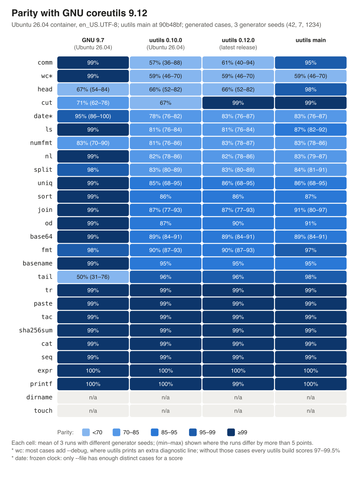

# How close are Ubuntu 26.04's Rust coreutils to GNU? I diffed 27 utilities

*Made with [port-anything](../../README.md), which checks that a rewrite still behaves like the program it replaces: `npx port-anything compare <reference> <candidate>`.*

Ubuntu 26.04 LTS replaced GNU coreutils with uutils, the Rust rewrite. I wanted to know how close the two are, so I ran both on about 2,000 generated cases per utility for 27 utilities and scored them against current GNU (9.12).

The short version:

- **Most utilities match on almost everything.** cat, tac, tr, paste, seq, sha256sum and expr are at 99–100% in every build.
- **The gaps are real but narrow**, and mostly on edge cases: invalid UTF-8, locale-dependent ordering, numbers past 2^63, unusual flag combinations.
- **uutils `main` has already closed several of the biggest ones** (head, cut, comm, fmt). Ubuntu 26.04 ships 0.10.0, which doesn't have those fixes yet.
- **GNU moved too.** Ubuntu's *GNU* 9.7, which it still ships as `gnu*`, is about as far from GNU 9.12 as uutils is on head and cut, and further on tail. Part of "uutils differs from GNU" is "GNU 9.7 differs from GNU 9.12".

Ubuntu 26.04 LTS ships uutils (the Rust rewrite) as `coreutils` and keeps GNU coreutils 9.7 next to it as `gnu*`. The April release had uutils 0.8.0; an update in September (`0.10.0-1ubuntu2~26.04.1`, in 26.04.1) moved it to 0.10.0, which is what this tests. 0.8.0 isn't tested. This compares both, plus uutils 0.12.0 (the latest release) and uutils `main`, against GNU coreutils 9.12, the current GNU release, on 27 utilities.



## Results

Parity = the mean, over a utility's flags, of the share of generated cases where the candidate matches GNU 9.12 (exit status, stdout, stderr, changed files). Each cell is the mean of three runs whose corpora were generated with different seeds (42, 7, 1234); the range is shown where the runs differ by more than 5 points. `n/a`: too few cases per flag for a score.

| utility | GNU 9.7 (Ubuntu) | uutils 0.10.0 (Ubuntu) | uutils 0.12.0 | uutils main |
|---|---|---|---|---|
| base64 | 99% | 89% (84–91) | 89% (84–91) | 89% (84–91) |
| basename | 99% | 95% | 95% | 95% |
| cat | 99% | 99% | 99% | 99% |
| comm | 99% | 57% (36–88) | 61% (40–94) | 95% |
| cut | 71% (62–76) | 67% | 99% | 99% |
| date | 95% (86–100) | 78% (76–82) | 83% (76–87) | 83% (76–87) |
| dirname | n/a | n/a | n/a | n/a |
| expr | 100% | 100% | 100% | 100% |
| fmt | 98% | 90% (87–93) | 90% (87–93) | 97% |
| head | 67% (54–84) | 66% (52–82) | 66% (52–82) | 98% |
| join | 99% | 87% (77–93) | 87% (77–93) | 91% (80–97) |
| ls | 99% | 81% (76–84) | 81% (76–84) | 87% (82–92) |
| nl | 99% | 82% (78–86) | 82% (78–86) | 83% (79–87) |
| numfmt | 83% (70–90) | 81% (76–86) | 83% (78–87) | 83% (78–86) |
| od | 99% | 87% | 90% | 91% |
| paste | 99% | 99% | 99% | 99% |
| printf | 100% | 100% | 99% | 100% |
| seq | 99% | 99% | 99% | 99% |
| sha256sum | 99% | 99% | 99% | 99% |
| sort | 99% | 86% | 86% | 87% |
| split | 98% | 83% (80–89) | 83% (80–89) | 84% (81–91) |
| tac | 99% | 99% | 99% | 99% |
| tail | 50% (31–76) | 96% | 96% | 98% |
| touch | n/a | n/a | n/a | n/a |
| tr | 99% | 99% | 99% | 99% |
| uniq | 99% | 85% (68–95) | 86% (68–95) | 86% (68–95) |
| wc | 99% | 59% (46–70) | 59% (46–70) | 59% (46–70) |

Read these with care:

- **The cases are generated edge cases, not real scripts**: every flag, boundary values (2^64, negative numbers), invalid UTF-8, odd flag combinations. A low score says a utility differs on such inputs, not that typical scripts break.
- **Few distinct command lines.** About 2,000 cases per utility come from 10 to 500 distinct command lines (`results/cases-and-command-lines.csv`); the rest vary the input. Which command lines a seed draws moves some cells by more than 20 points, hence three seeds and the ranges.
- **wc:** most cases add `--debug`, where uutils prints an extra diagnostic line and GNU prints none. Without those cases every uutils build scores 97–99.5%.
- **date** runs with a frozen clock (libfaketime), so only `date --file` has enough distinct cases for a score.
- **Locale:** `en_US.UTF-8`. In `C.UTF-8` (port-anything's default), sort and comm score about 5 points higher for uutils; everything else moves by less than 1.5.
- GNU 9.7 is scored against GNU 9.12 too: part of the distance between Ubuntu's tools and current GNU is GNU's own changes since 9.7 (`cut -F`, quoted `head`/`tail` headers, new `--debug` options).

## Examples

**Fixed upstream, not in Ubuntu 26.04 yet.** These are the ones an Ubuntu user is most likely to hit today:

- `comm` in `en_US.UTF-8` on two files sorted by the same system's `sort`:
  ```sh
  printf 'apple\nBanana\ncherry\n' > a; printf 'Apple\nbanana\ncherry\n' > b
  comm -12 a b
  ```
  Ubuntu's uutils 0.10.0 prints `comm: file 1 is not in sorted order` and exits 1; GNU and uutils 0.12.0+ print `cherry` and exit 0. Fixed by [#14047](https://github.com/uutils/coreutils/pull/14047) (merged 2026-08-29).
- Plain `ls` in a home directory: 0.10.0 lists `Desktop Documents Videos` before `snap test.sh` (byte order); GNU and uutils 0.12.0+ sort by the locale. Reported in [#12474](https://github.com/uutils/coreutils/issues/12474), fixed by [#11841](https://github.com/uutils/coreutils/pull/11841).
- `nl -v -1` (start numbering at -1) is rejected by every uutils build I tested; fixed on `main` on 2026-11-02 ([#15999](https://github.com/uutils/coreutils/issues/15999), PR [#16018](https://github.com/uutils/coreutils/pull/16018)), after these runs.

**GNU's own drift.** GNU 9.12 quotes the header `head -v` prints for standard input; 9.7 doesn't:
```sh
printf 'a\n' | head -v
```
GNU 9.12 and uutils `main` print `==> 'standard input' <==`, while GNU 9.7 and uutils 0.10.0/0.12.0 print `==> standard input <==`. Likewise `cut -F` exists in GNU 9.11+ and uutils 0.12.0+, but not in Ubuntu's GNU 9.7.

**Still open upstream**, already reported by others:
- `od -w FILE` takes `FILE` as the width ([#10725](https://github.com/uutils/coreutils/issues/10725)).
- `sort --parallel 100000` on a 3-line file runs past a 5 s timeout; GNU returns at once ([#13198](https://github.com/uutils/coreutils/issues/13198)).
- Ties after `sort -n` are broken in byte order instead of the locale's: `printf 'b\nB\na\nA\n' | sort -n` gives `a A b B` in GNU and `A B a b` in uutils ([#13319](https://github.com/uutils/coreutils/issues/13319) is the same cause).
- Many more are listed in [#15254](https://github.com/uutils/coreutils/issues/15254), a larger fuzzing report.

`examples.sh` replays the one-line examples on all five builds:

```sh
docker run --rm ubuntu-uutils bash /ub/examples.sh
```

## Setup

- Ubuntu 26.04.1 LTS container, x86_64, bubblewrap sandbox, 5 s timeout per case.
- GNU coreutils 9.12 built from the GNU tarball (sha256 `a480198559733e9b3da999e90543ac6f888a2caa544d8d664c5a1f17e528e210`); GNU 9.7 = Ubuntu's `gnu-coreutils`; uutils 0.10.0 = Ubuntu's `/usr/bin/coreutils` (`rust-coreutils` `0.10.0-1ubuntu2~26.04.1`); uutils 0.12.0 release binary; uutils `main` at [`90b48bf`](https://github.com/uutils/coreutils/commit/90b48bf2c150dcec9756dba8fcb7a73bc0b1d3bc) (reports 0.13.0).
- port-anything 0.1.3. Each utility's corpus: 1,000 cases generated from GNU 9.12's `--help` (seed 42, 7 or 1234, stored in `corpus/`), plus about 1,000 more that `run` derives from them by mutation.
- `cp`, `mv` and `ln` are left out (Ubuntu keeps `cp` and `mv` on GNU; `ln` needs a file setup this run doesn't do).
- How this differs from uutils' own number: uutils runs GNU 9.12's test suite (664 of 720 tests pass as of 2026-10-30, [coreutils-tracking](https://github.com/uutils/coreutils-tracking)). Those are GNU's hand-written tests over all utilities; this is generated cases per flag over 27.

## Reproduce

```sh
docker build -t ubuntu-uutils .
for s in 42 7 1234; do
  docker run --rm --init --security-opt seccomp=unconfined --security-opt apparmor=unconfined \
    --security-opt systempaths=unconfined -v "$PWD/out:/out" -e OUT=/out/seed$s -e SEED=$s ubuntu-uutils /ub/run.sh
done
```

About 1 h 40 min per seed on a 2019 Intel laptop. Each utility's `out/seed<S>/<util>/run.txt` has the parity per candidate; `port-anything run --cluster <n>` inside a project shows what differs. A rerun lands within about a point of the table: the run excludes cases whose reference output changes between re-runs, and a few cases time out under load.

The sandbox needs the three `--security-opt` flags (bubblewrap creates namespaces inside the container).

## Files

- `Dockerfile`, `run.sh`, `examples.sh`: the image and the scripts above.
- `corpus/seed<S>/<util>.jsonl.gz`: the generated cases (argv, stdin, input files) per seed.
- `results/parity.csv`: every cell, per seed and the mean. `results/cases-and-command-lines.csv`: cases and distinct command lines per utility and seed. `results/versions.txt`: tool and binary versions.
- `results/heatmap.svg|png`: the full chart; `results/heatmap-social.svg|png`: 11 rows, 1200×675.

## How it was made

I built [port-anything](../../README.md) to check that a rewrite still behaves like the program it replaces. It reads the reference's `--help`, generates cases per flag, runs every side in a sandbox and scores the differences. On Ubuntu 26.04, where GNU sort is installed as `gnusort` (about a minute; it scores 91.5% there):

```sh
npx port-anything compare gnusort 'coreutils sort' --budget 1000
```

Thanks to the uutils maintainers: several of the gaps in the 0.10.0 column were already fixed by the time I looked.
